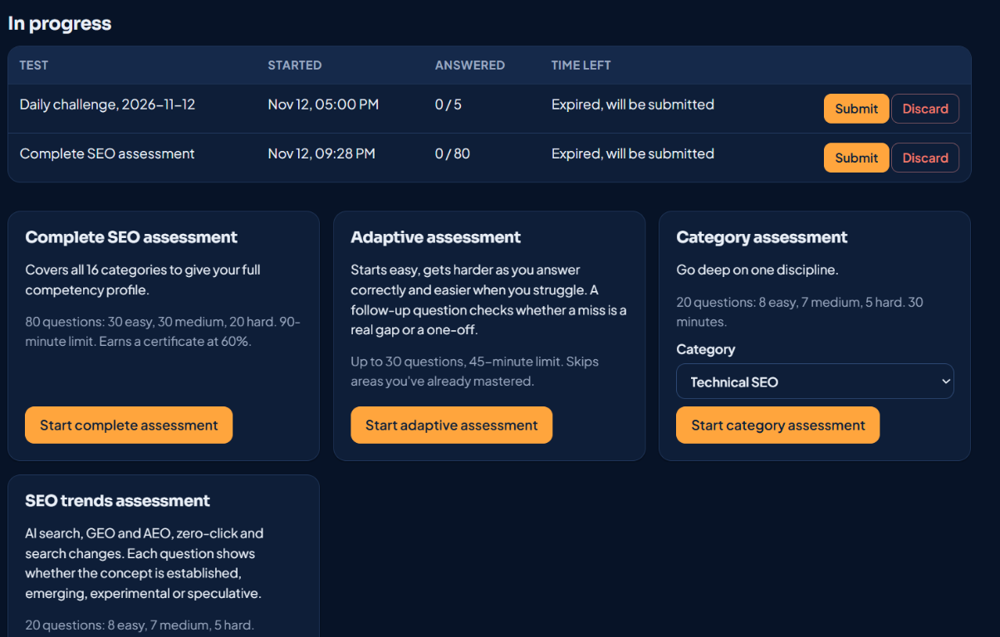
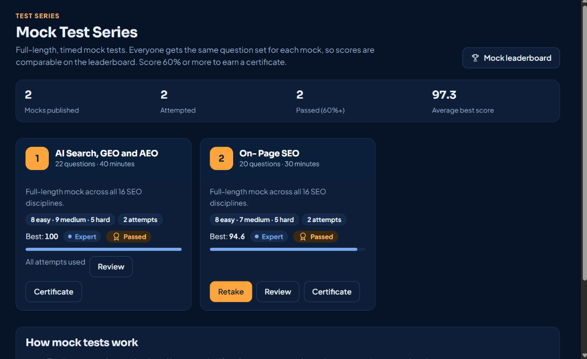
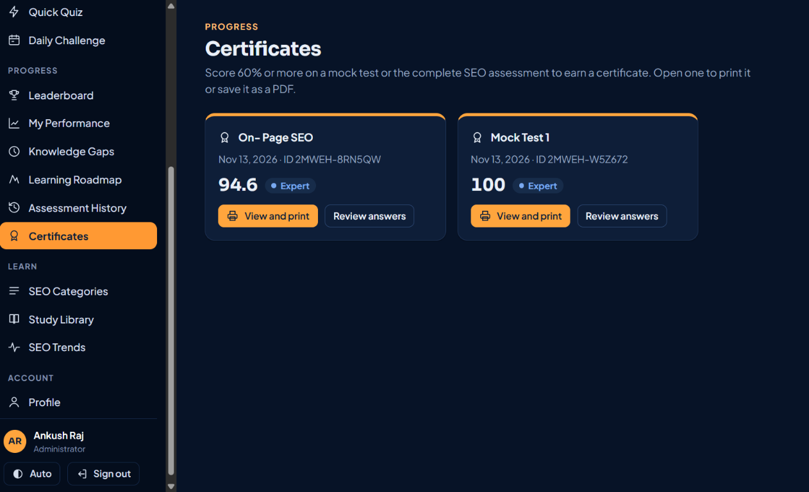
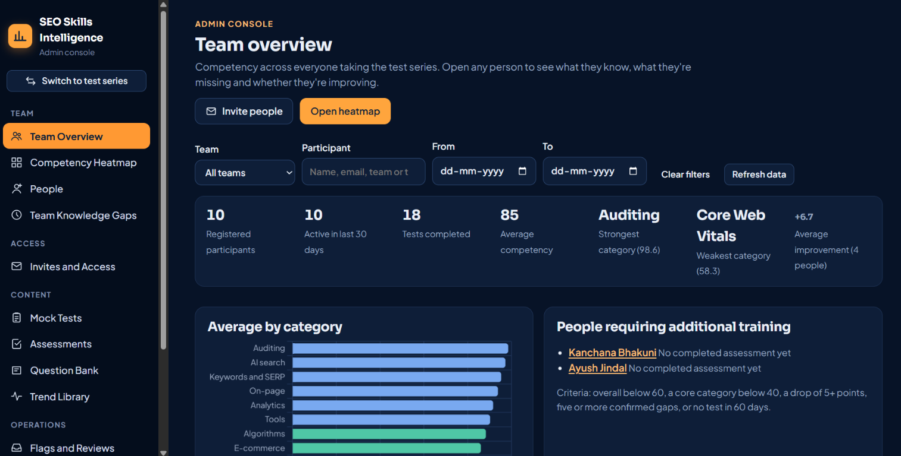
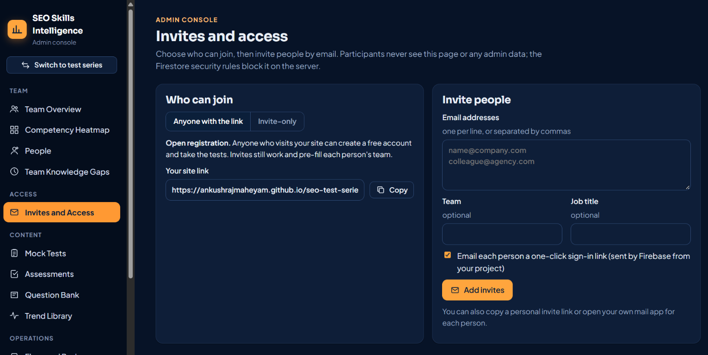
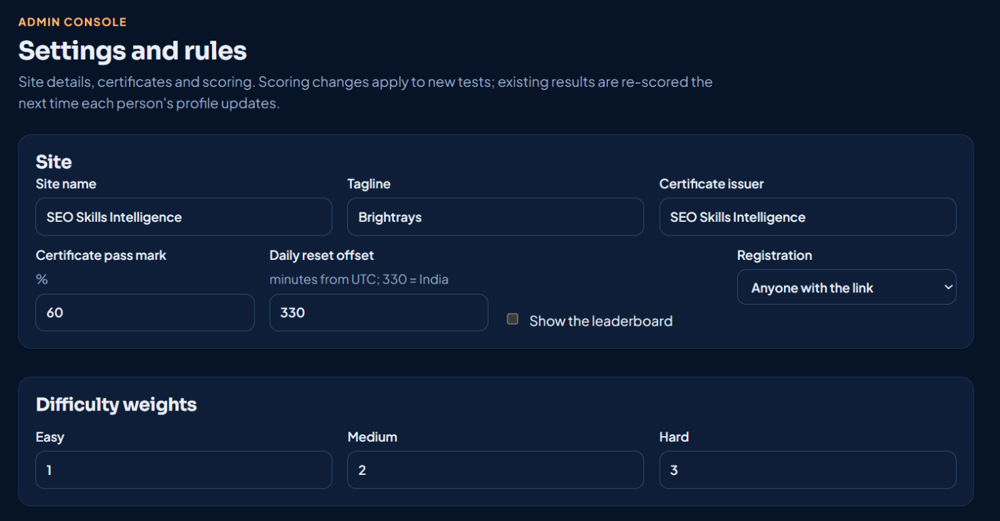

# SEO Skills Intelligence — SEO Test Series

A complete, self-hosted SEO test series: mock tests, adaptive assessments across 16 SEO disciplines, a daily challenge, a quick quiz, a leaderboard, certificates and a full admin console with email invitations.

It's a static website (HTML, CSS, JavaScript) that you host free on **GitHub Pages**, with **Firebase** (Authentication + Firestore) as the backend for accounts, results and security.

## What participants get

| Menu | What it does |
|---|---|
| **Dashboard** | Competency score (0–100), level, accuracy by difficulty, category scores, weak and strong areas |
| **Mock Test Series** | Numbered, timed, full-length mocks. Same questions for everyone, best score on the leaderboard |
| **Take Assessment** | Complete (80 Q), adaptive, category and trends assessments, plus untimed practice |
| **Quick Quiz** | 10 questions in 10 minutes, all categories or one |
| **Daily Challenge** | 5 questions a day, identical for everyone, with streaks and a daily top 10 |
| **Leaderboard** | Overall competency, mock tests, today's challenge and streaks (names only, no emails) |
| **My Performance / Knowledge Gaps / Learning Roadmap / History** | Charts, confirmed gaps, a personalised study plan and every past attempt |
| **Certificates** | Printable certificate for passing a mock or the complete assessment (default 60%) |
| **Study Library** | Every official resource behind the questions, by category, with "studied" tracking |
| **SEO Categories / SEO Trends / Profile** | Subcategory scores, labelled industry trends and account settings |

## What the admin gets

Team overview, competency heatmap, people (disable access, grant admin), **Invites and Access** (open sign-up or invite-only, email invitations), **Mock Tests** (generate a whole series in one click), custom assessments, question bank editor with JSON import/export, rubric grading for open answers, question reports, trend library, CSV/HTML reports and site settings.

Participants never see the admin console. The Firestore security rules in `firebase/firestore.rules` block every admin read and write on the server, not just in the interface.

## Participant screenshots

| Dashboard | Assessment options |
|---|---|
|  |  |

| Mock test series | Certificates |
|---|---|
|  |  |

**Certificate example**


## Admin screenshots

| Team overview | Competency heatmap |
|---|---|
|  |  |

| Team knowledge gaps | Invites and access |
|---|---|
|  |  |

**Settings and rules**



## How it fits together

```
 Browser ──► GitHub Pages (index.html, css/, js/)        ← this repository
    │
    └────► Firebase Authentication  (email + password, email-link invites)
    └────► Cloud Firestore          (profiles, results, questions, answer keys)
                 ▲
                 └── firebase/firestore.rules  ← the backend's security logic
```

## Set up in about 20 minutes

1. Create a free Firebase project, enable **Email/Password** and **Email link** sign-in, and create a Firestore database.
2. Publish `firebase/firestore.rules` in Firestore > Rules.
3. Paste your Firebase web config into `js/firebase-config.js`.
4. Upload this folder to a GitHub repository and turn on **GitHub Pages** (Settings > Pages > main / root).
5. Add `<your-username>.github.io` to Firebase **Authorized domains**.
6. Open your site, create your account, then add a document `admins/<your UID>` in Firestore to become the admin.
7. In the admin console, import `private-question-bank/questions.json` (kept outside this repo), generate mock tests and invite people.

The full click-by-click guide is in **[docs/SETUP_GUIDE.md](docs/SETUP_GUIDE.md)**.

## Project structure

```
seo-test-series/
├── index.html                 App shell (loads everything below)
├── css/
│   └── styles.css             Saffron + navy theme, light and dark mode
├── js/
│   ├── firebase-config.js     ← paste your Firebase config here
│   ├── firebase.js            Loads the Firebase SDK (Auth + Firestore)
│   ├── taxonomy.js            16 categories, subcategories, learning resources
│   ├── core.js                Data layer, grading, competency model, adaptive engine
│   ├── ui.js                  Navigation, routing, shared components, charts
│   ├── auth.js                Sign-in, registration, invites, onboarding, app start
│   ├── views.js               Dashboard, assessments, test runner, review, practice, progress pages
│   ├── series.js              Mock tests, quick quiz, daily challenge, leaderboard, certificates, library
│   └── admin.js               Admin console (loaded only for administrators)
├── firebase/
│   ├── firestore.rules        Security rules (the backend)
│   └── firestore.indexes.json
├── assets/favicon.svg
├── docs/
│   ├── SETUP_GUIDE.md         Step-by-step deployment
│   ├── ADMIN_GUIDE.md         Running the test series day to day
│   ├── SECURITY.md            What is protected, and how
│   ├── images/                Local-only screenshots; excluded from Git
│   └── screenshots/           Screenshots shown in this README
├── firebase.json / .firebaserc  Optional: deploy rules with the Firebase CLI
├── .gitignore                 Keeps the private question bank out of Git
└── .nojekyll                  Tells GitHub Pages to serve files as-is
```

The question bank with answers (`private-question-bank/`) ships **next to** this folder, not inside it. Keep it on your computer and import it through the admin console; never upload it to a public repository.

## Costs

Firebase's free Spark plan covers a small-to-medium test series (50,000 document reads and 20,000 writes per day). A participant session reads roughly 30–60 documents plus one per answer revealed; a 50-question mock writes about 5 documents. GitHub Pages is free for public repositories.

## Credits

Built for the SEO test series. Question content cites official documentation (Google Search Central, web.dev, Schema.org, Google Analytics Help and vendor docs).

## About Me

Created by [Ankush Raj](https://github.com/AnkushRajMaheYam/) · [LinkedIn](https://www.linkedin.com/in/ankushrajmaheyam/).
